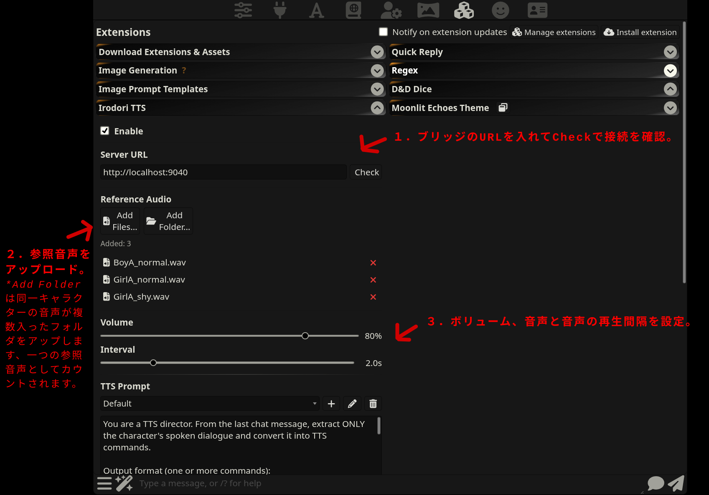
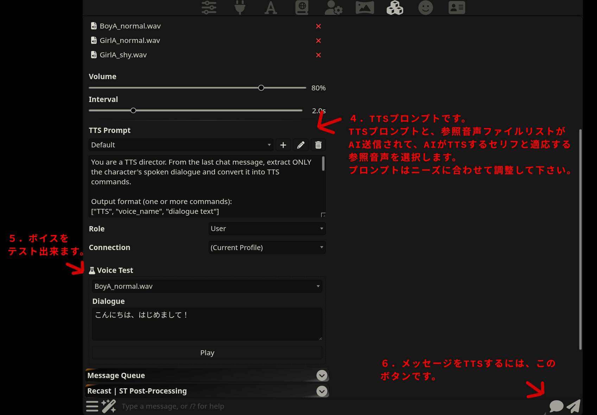

[English](README.md) 

# SillyTavern-IrodoriTTS

SillyTavernから[Irodori-TTS](https://github.com/Aratako/Irodori-TTS)のボイスクローンを利用する為のExtensionです。<br />
AIがセリフを抽出し各セリフに相応しい参照音声を選択します、複数のキャラクターが次々と喋ります！

**特徴:**
- シンプルな使い心地
- キャラクターの声として、数秒〜数十秒の参照音声を使用する
- 参照音声は好きな数だけ使用可能
- ワンクリックで、最終メッセージのセリフが全てそれぞれのキャラクター・声のトーンで再生
- 音声の再生中も推論を続けるので、ボイスとボイスの間の待ち時間無し
- Vastai/RunpodでTTSサーバーを動かせばGPUは不用です


# インストール
**Linux環境でテストしました、不明点や問題があればこのリポジトリをAIに投げて質問してみて下さい。*

**1. IrodoriTTSをインストール**

必須ではありませんがDocker/Podmanコンテナ内でインストールするなら：
```
# コンテナ作成、podmanでは以下のようなコマンド
podman run -d --device nvidia.com/gpu=all --name irodori-tts --network=host ubuntu:24.04 sleep infinity

# GPUが利用できる事を確認
nvidia-smi

# システムをアップデート、必要なものがあればインストール、TTSサーバーを動かす為のuserアカウントを作成
```

それでは[Irodori-TTS](https://github.com/Aratako/Irodori-TTS)をインストールし、正常に動いている事を確認して下さい。


**2. st-irodori-bridgeをインストール**<br />
[st-irodori-bridge](https://github.com/myonmu0/st-irodori-bridge)はSillyTavernとIrodori-TTSを繋げる為のブリッジです。
```
# インストール
git clone https://github.com/myonmu0/st-irodori-bridge

# 起動
cd /path/to/your/Irodori-TTS
. .venv/bin/activate
cd /path/to/your/st-irodori-bridge
python3 ./st-irodori-bridge.py -v --irodori-dir /path/to/your/Irodori-TTS --host 127.0.0.1 --port 9040
```
**/path/to/your部分は変更して下さい。*
<br />
**VRAMを削減したい場合は --bf16, --quant int8, --quant int4のいずれかを追加して起動して下さい。*
<br />
**このブリッジはローカルアクセス前提で作られています、ネット上の不特定多数がアクセス出来ないようにローカルで（127.0.0.1など）動かして下さい。Vastai/Runpodで動かす場合はポートを開かずにSSHトンネル経由で利用して下さい。*

**3. SillyTavern-IrodoriTTSをインストール**<br />
SillyTavern > Extensions > Install extension > このリポジトリのURLをコピーペーストしてインストール。


# 使い方

**1. 参照音声を準備する**<br />
まずは参照音声が必要です。数秒〜数十秒で、BGMの無いクリアーなキャラクターの声を用意しましょう。ファイル名は「キャラ名_感情.wav」みたいな感じで、日本語でも大丈夫です。

役立つツール： 
- 音声とBGMの分離： https://github.com/tsurumeso/vocal-remover

- kdenlive： 動画や音声から任意の範囲をカットして保存。例えば動画・音声をタイムラインに乗せて再生し、いい感じのボイスの位置で"i"キーを押す、再生させてボイスが終わる頃に"o"キーを押すと、その範囲（いい感じの声）が選択されます。次にCTRL+ENTERを押し、”選択した範囲”と”オーディオのみ”選んでから”ファイルにレンダリング”をする事でその部分をファイルに保存できます。


**2. 設定**<br />
 <br />


備考：
- Chat HistoryはTTSでAIに送信する最新メッセージ件数です、少ない方が高速ですが精度が落ちる可能性があります。0を指定すると全件送信。
- ブリッジを忘れずに起動して下さい。
- TTS Promptはニーズにあったものに変更できます。例えばキャラAの声は音声Aにしてと書いたり、メインキャラのA,B、C以外はTTSしないでと書いたり、他にも調整が出来ます。デフォルトでは最終メッセージのセリフを全てTTSします。日本語で書いても大丈夫だと思います。
- アップロードした参照音声はブラウザをリロードすると消えます。
- Chat Completionを想定しております、Text Completionはサポートされていません。
<br />

**3. TTSを実行する**<br />
初回はTTS用の接続プロファイルを作っておくと問題が起こりにくいです。
1. SillyTavern > API Connection(🔌マーク）
2. 論理に強いモデル（GLM, DeepSeekの最新版など安くて強い）を選び、Thinkingするようにします。"Max Response Length (tokens)"は20000とかに増やします。
3. "Create new connection profile"を押して接続プロファイルを作成。
4. Irodori TTSにあるConnectionからそのプロファイルを指定する。

それでは既存チャットを開き、TTSボタンを押してしばらく待ってみて下さい。
音声再生中にTTSボタンを押すと一時停止、ダブルクリックでTTSキャンセル。

### トラブルシューティング
#### 接続エラー
TTSサーバーとブリッジが正しく動作しているか確認を行って下さい。

#### AIがTTSコマンドを正しく作ってくれない
- SillyTavernを実行しているターミナルでは送信されたTTSプロンプトとAIの応答を見れます、これを見ながら挑戦してみて下さい。
- RoleをUser/Systemに変えてみる
- 参照音声の名前をストーリーのキャラクターとマッチするように変えてみる
- TTS Promptを編集してみる
- Chat Historyを増やしてみる

#### 声がイマイチ
Voice Testフィールドで参照音声をテストしてみて下さい。


Enjoy ;)


